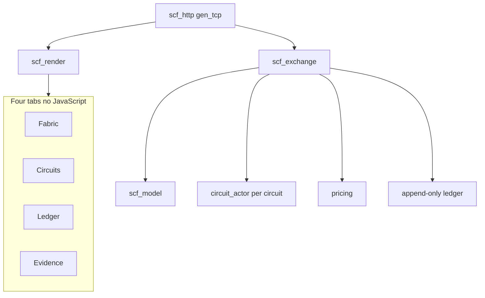
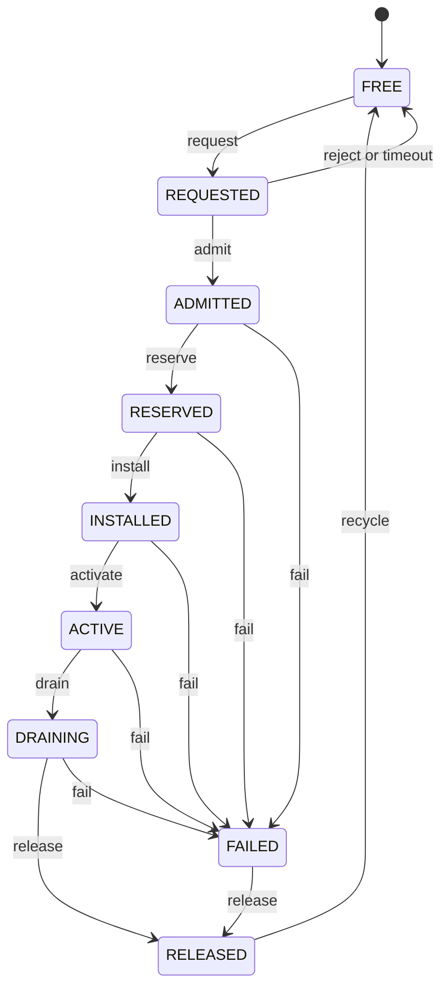
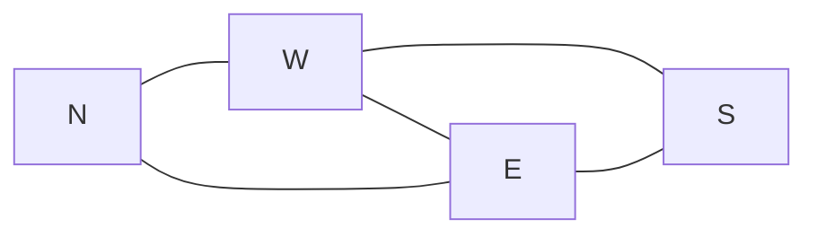

# Sovereign Circuit Fabric — Console

Phase I exchange console on **Erlang/OTP (BEAM)**. Server-rendered HTML only — no JavaScript. Every action is a link or a form post; the exchange re-renders the page.

This is the running console for the model defined in [sovereign-circuit-fabric](https://github.com/AHMADALIPARR/sovereign-circuit-fabric). It **executes** the exchange rather than only documenting it.

---

## Screenshots

<p align="center">
  
  &nbsp;
  
</p>

<p align="center"><sub>Fabric · Circuits — BEAM console, local render</sub></p>

---

## Architecture map



Full diagram asset: [docs/images/architecture.svg](docs/images/architecture.svg)

---

## What runs

| Concern | Implementation |
| --- | --- |
| Lifecycle legality | One `circuit_actor` gen_statem per circuit |
| Charges | `pricing.erl` fixed-point integer components |
| Topology | Four nodes N W E S — edge 10 Mb/s, backbone W–E 20 Mb/s |
| Admission | Deterministic shortest path with per-link reservation |
| Tariffs | Version locked at admission |
| Frames | 20-byte circuit frame, magic SCF, network order, Internet checksum |
| Audit | Append-only ledger + transaction transcript with idempotent replay |
| Evidence | Nine invariants checked on every render |

`beam/circuit_actor.erl` and `beam/pricing.erl` are copies of the modules in sovereign-circuit-fabric (`control/beam/circuit_actor.erl`, `accounting/pricing.erl`). That repo is the authority; changes land there first and are re-copied.

---

## Circuit lifecycle



Illegal transitions are rejected by the owning actor process.

---

## Pricing

```text
Charge = SetupFee + ReservedCapacityCharge + UsageCharge + PriorityCharge
```

- **Setup** posts at admission  
- **Reservation** posts once per clock second while bandwidth is held including FAILED  
- **Usage** and **priority** post once on release  
- All values are integer minor units — no binary floating point  

Reference suite vector settles **2500** minor units (0.2500) both in-process and over HTTP: ESTABLISHMENT, ten RESERVATION events, FINAL.

---

## Reference topology



- Edge links: 10 Mb/s  
- Backbone W–E: 20 Mb/s  
- Capacities are reference values so exhaustion is observable — not measured hardware  

---

## Module layout

| Module | Role |
| --- | --- |
| `beam/scf_console.erl` | Entry point |
| `beam/scf_http.erl` | Small HTTP/1.1 server on gen_tcp |
| `beam/scf_render.erl` | Fabric, Circuits, Ledger, Evidence tabs as HTML/CSS |
| `beam/scf_exchange.erl` | Fabric state, commands, actors, ledger, transcript |
| `beam/scf_model.erl` | Topology, admission, pathfinding, frame codec, invariants |
| `beam/circuit_actor.erl` | Per-circuit gen_statem lifecycle |
| `beam/pricing.erl` | Fixed-point charge components |
| `beam/scf_console_test.erl` | Test suite |

Static GitHub Pages copies live at the repo root and under `docs/` (Fabric, Circuits, Ledger, Evidence, stylesheet). Pages is static only — forms do not run the exchange. Interactive use requires the BEAM server.

---

## Run

```sh
./run.sh            # serve on SCF_PORT default 8080
./run_tests.sh      # compile and run the suite
```

Requires a local Erlang/OTP install (`erlc`, `erl`).

---

## Evidence and limits

See [STATUS.md](STATUS.md) for plain facts.

- Suite: 9 tests, all passing; nine model invariants after every successful command  
- HTTP-driven full lifecycle: create through release, link failure, tariff revision, reset  
- All four tabs render with no JavaScript  
- Exchange state is in-process only — restart resets to the reference topology  
- Not run here: p4c, GHDL, Why3, Dafny those stay on the source fabric repo  

---

## License

SnapKitty Opaque Source License, Version 1.0 — see `LICENSE`.  
SPDX-License-Identifier: LicenseRef-Sovereign-Leviathan-SL-AGPL3-001  
Copyright © 2026 SnapKitty West. All rights reserved.
