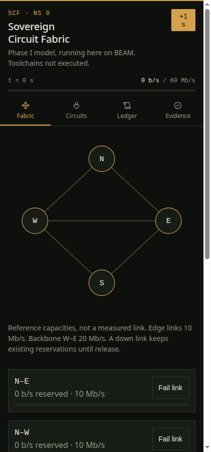
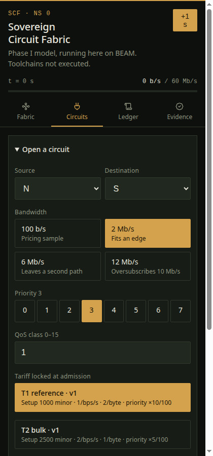

# circuit-fabric

BEAM console for the Sovereign Circuit Fabric Phase I model.

One process per circuit. Integer pricing. Four-node topology. Form posts, no client JS. State dies with the VM.

Authority tree: [sovereign-circuit-fabric](https://github.com/AHMADALIPARR/sovereign-circuit-fabric)  
Actors and pricing here are copies of that tree’s `circuit_actor.erl` / `pricing.erl`.

---

## Console

<p align="center">


</p>

```sh
./run.sh          # SCF_PORT=8080
./run_tests.sh    # 9 tests
```

| Tab | Serves |
| --- | --- |
| Fabric | topology, link load, create circuit |
| Circuits | per-circuit state, advance lifecycle |
| Ledger | append-only charge events |
| Evidence | nine invariants on the live model |

Static snapshots (Pages, read-only): `index.html` `circuits.html` `ledger.html` `evidence.html`

---

## Topology

```text
        N
       / \
     10   10
     /     \
    W ——20—— E
     \     /
     10   10
       \ /
        S
```

| Edge | Mb/s |
| --- | ---: |
| N–W | 10 |
| N–E | 10 |
| W–S | 10 |
| E–S | 10 |
| W–E | 20 |

Shortest path. Reserve on every hop or reject.

---

## Lifecycle

| State | Next |
| --- | --- |
| FREE | REQUESTED |
| REQUESTED | ADMITTED / FREE |
| ADMITTED | RESERVED / FAILED |
| RESERVED | INSTALLED / FAILED |
| INSTALLED | ACTIVE / FAILED |
| ACTIVE | DRAINING / FAILED |
| DRAINING | RELEASED / FAILED |
| FAILED | RELEASED |
| RELEASED | FREE |

Illegal moves die in the owning `gen_statem`.

---

## Money

```text
charge = setup + reserved + usage + priority
```

| Component | Trigger |
| --- | --- |
| setup | admit |
| reserved | each second while held |
| usage | release |
| priority | release |

Minor units only. Fixture settles **2500**.

---

## Modules

| File | Job |
| --- | --- |
| `beam/scf_console.erl` | boot |
| `beam/scf_http.erl` | gen_tcp HTTP/1.1 |
| `beam/scf_render.erl` | HTML tabs |
| `beam/scf_exchange.erl` | fabric + ledger + transcript |
| `beam/scf_model.erl` | paths, frames, invariants |
| `beam/circuit_actor.erl` | lifecycle machine |
| `beam/pricing.erl` | fixed-point charge |
| `beam/scf_console_test.erl` | suite |

Frame: 20 bytes, magic SCF, network order, Internet checksum.

---

## Checks

| Item | Result |
| --- | --- |
| suite | 9/9 |
| invariants | 9, after every successful command |
| HTTP drive | create → release, fail, tariff, reset |
| persistence | none |

`STATUS.md` has the rest.

---

## License

SnapKitty Opaque Source License 1.0 — `LICENSE`  
© 2026 SnapKitty West
