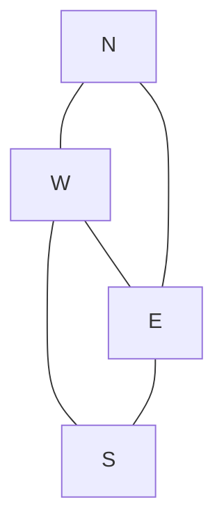
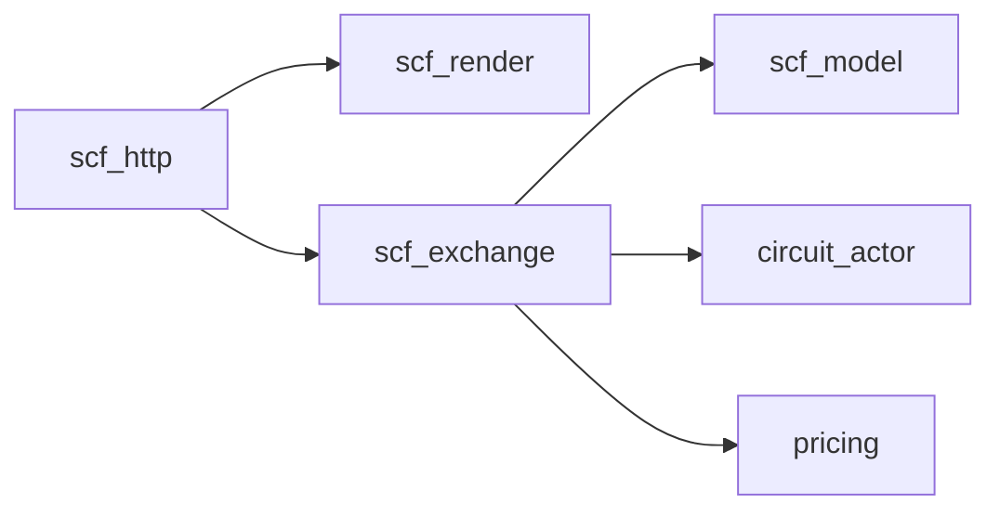
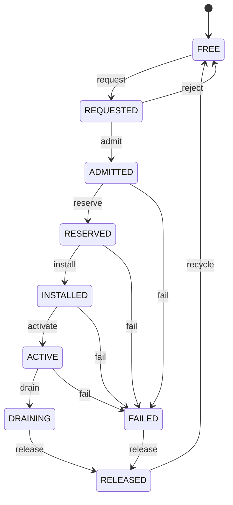

# Circuit Fabric

Phase I exchange console on Erlang/OTP. Server-rendered HTML, no JavaScript in the exchange UI. Form posts drive a live BEAM model: topology, admission, per-circuit actors, fixed-point pricing, ledger.

Source model: [sovereign-circuit-fabric](https://github.com/AHMADALIPARR/sovereign-circuit-fabric).

---

## Interactive 2D circuits

Open the map and click a circuit to highlight its path on the fabric:

**[Open 2D circuit map](circuits-2d.html)** · [docs copy](docs/circuits-2d.html)



| Link | Capacity |
| --- | --- |
| N–W, N–E, W–S, E–S | 10 Mb/s |
| W–E backbone | 20 Mb/s |

Admission uses deterministic shortest path with per-link reservation.

---

## Console shots

<p align="center">
  
  
</p>

Static tab renders: [Fabric](index.html) · [Circuits](circuits.html) · [Ledger](ledger.html) · [Evidence](evidence.html)

---

## Stack



| Module | Role |
| --- | --- |
| scf_console | Entry |
| scf_http | HTTP/1.1 on gen_tcp |
| scf_render | Four tabs as HTML |
| scf_exchange | State, commands, ledger |
| scf_model | Topology, frames, invariants |
| circuit_actor | One gen_statem per circuit |
| pricing | Integer minor-unit charges |

---

## Lifecycle



| Stage | Meaning |
| --- | --- |
| FREE | No resources |
| REQUESTED | Awaiting admit |
| ADMITTED | Policy accepted, tariff locked |
| RESERVED | Bandwidth held on path |
| INSTALLED | Forwarding entries set |
| ACTIVE | Carrying traffic |
| DRAINING | Teardown in progress |
| RELEASED | Final charge posted |
| FAILED | Fault; still must release |

---

## Pricing

```text
Charge = Setup + ReservedCapacity + Usage + Priority
```

| Event | When |
| --- | --- |
| Setup | Admission |
| Reservation | Each clock second while held |
| Usage + priority | Once on release |

Integer minor units only. Suite vector: **2500** minor units.

---

## Run

```sh
./run.sh         # SCF_PORT default 8080
./run_tests.sh   # 9 tests
```

Needs `erlc` and `erl`. Exchange state is in-memory; restart resets the fabric.

---

## Evidence

| Check | Result |
| --- | --- |
| Model suite | 9 tests pass |
| Invariants | 9 checked after each command |
| HTTP lifecycle | create through release |
| Pages site | static snapshot only |

Details: [STATUS.md](STATUS.md)

---

## License

SnapKitty Opaque Source License 1.0 — see `LICENSE`.  
Copyright © 2026 SnapKitty West.
